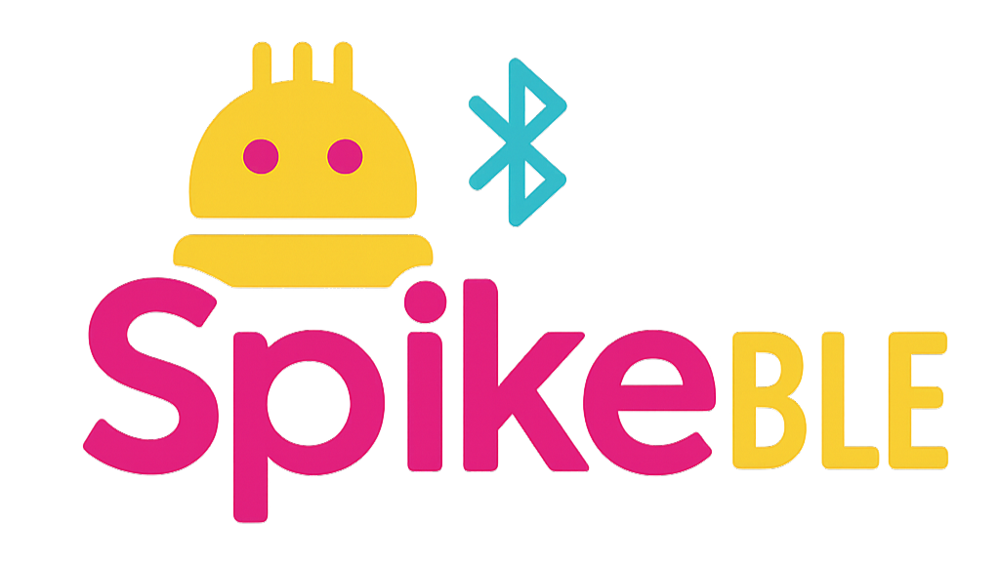
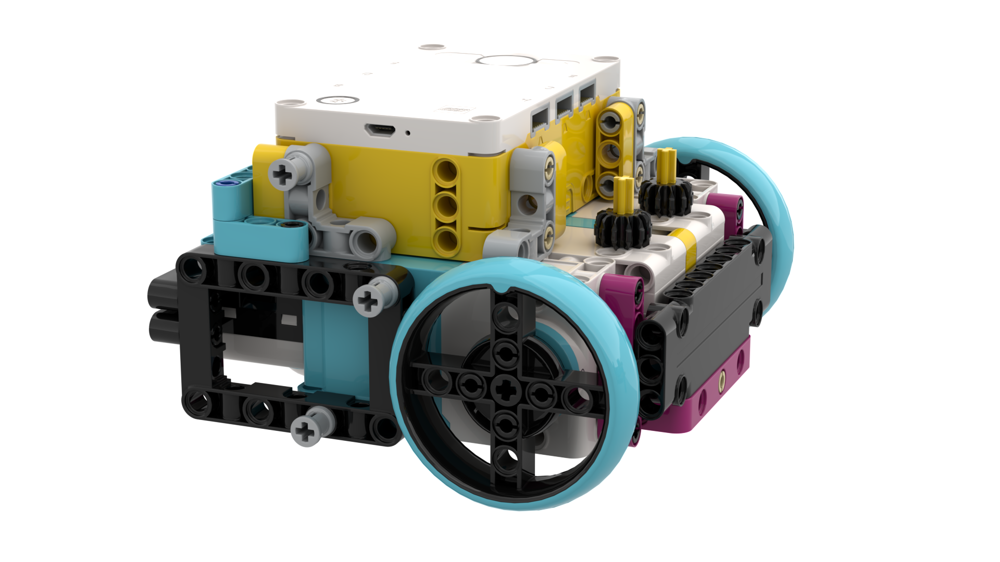

<h1 align="center">
    
</h1>
<p align="center">
    <sub>(pronounced "spike-ble")</sub>
    <br>
    
</p>

## Installation

*From PyPI:*

```console
pip install spikeble
```

*From GitHub:*

```console
pip install git+https://github.com/MGross21/spikeble.git
```

> **Note:**
> `spikeble` ships type stubs (`.pyi`) for the SPIKE MicroPython modules (`app`, `color`, `color_matrix`, `color_sensor`, `device`, `distance_sensor`, `force_sensor`, `hub`, `motor`, `motor_pair`, `orientation`, `runloop`). Editors get auto-complete and type checking, but the modules are not importable on your computer; they only exist on the hub. Pyright/Pylance may warn that an import "could not be resolved from source"; silence it with `reportMissingModuleSource = false`.

## Running Code on SPIKE

`spikeble.run(main)` uploads the body of `main()` to the hub without running it locally, so all MicroPython imports must go inside `main()`. Use the template below as a starting point for your SPIKE code:

```python
import spikeble
import asyncio

def main():
    # from app import sound, bargraph, display, linegraph, music
    import color
    import color_matrix
    import color_sensor
    import device
    import distance_sensor
    import force_sensor
    from hub import port, button, light, light_matrix, motion_sensor, sound
    import motor
    import motor_pair
    import orientation
    import runloop

    ### Insert Your Code Here ###

if __name__ == "__main__":
    asyncio.run(spikeble.run(main))
```

> **Note:**  
> As of `SPIKE™ Firmware v1.8.149` and `RPC v1.0.47`, using `import app` or `from app import ...` will result in an import error. The `app` module is currently disabled until further notice.

### Other Send Methods

You can also run code on the SPIKE using the following methods:

```python
spikeble.run_file("path/to/your_script.py")
```

```python
spikeble.run_str("print('Hello from SPIKE!')")
```

## Documentation

- [MicroPython Docs](https://spike.legoeducation.com/prime/modal/help/lls-help-python)
- [Communication Protocol](https://github.com/LEGO/spike-prime-docs)

## Updating the Stubs

The stubs in `stubs/` are generated from LEGO's official SPIKE App help content. To regenerate them, or to check whether they are out of date:

```console
python scripts/gen_stubs.py
python scripts/gen_stubs.py --check
```
<!-- - [Spike 3 Python Docs (Unofficial)](https://tuftsceeo.github.io/SPIKEPythonDocs/SPIKE3.html) -->